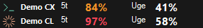
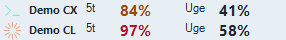

# BODK-AI-Use

Et lille Windows-værktøj, der viser **Codex- og Claude Code-kvoter direkte oven på proceslinjen**. Se forbruget for fem timer og en uge uden at åbne et separat vindue.

## Sådan ser det ud

Mørkt tema:



Lyst tema:



Billederne viser selve widgettens Windows-kontroller med **demotal**, ikke en måling fra en konto. Ved almindelig brug står der Codex og Claude i stedet for Demo CX og Demo CL. Symbolerne er tegnede udbydermærker, ikke officielle logoer.

## Installation

1. Vælg **Code → Download ZIP** på GitHub, og pak hele ZIP-filen ud.
2. Dobbeltklik på **Installer.cmd**.
3. Tallene vises til venstre for systemikonerne i den primære proceslinje.

Installationen gælder din Windows-bruger og kræver ikke administratorrettigheder. **Programmet starter automatisk, når du logger ind i Windows.** Det bruger den indbyggede Windows PowerShell 5.1 og Windows Forms.

Har du den gamle Kvoteblik installeret, skal du først afinstallere den via dens Afinstaller.cmd. Opdatér også din Claude-statuslinjes sti.

## Brug

- **Højreklik** på visningen for at vælge Codex, Claude eller begge.
- Vælg brugt eller resterende kvote, lyst/mørkt tema og opdateringsinterval.
- **Træk med venstre museknap** for at flytte visningen vandret. Placeringen gemmes.
- Hold musen over en procent for status og eventuelt nulstillingstidspunkt.
- Orange betyder over 80 % forbrugt; rød betyder over 95 %. Farven følger forbruget, også når du viser resterende kvote.
- En streg betyder, at en gyldig måling mangler. Demotilstand bruger kunstige eksempelværdier.

Begge udbydere vises som to kompakte rækker. Vælg én udbyder for én række.

### Placering og begrænsninger

Visningen ligger **oven på proceslinjen**. Den reserverer ikke plads og flytter ikke Windows' appknapper. Hvis den dækker en knap, træk den til et ledigt område. Højreklik → Nulstil placering gendanner udgangspunktet.

Placeringen følger den primære, vandrette proceslinje. Koden skjuler visningen, når proceslinjen er automatisk skjult eller et fuldskærmsprogram er aktivt, og finder proceslinjen igen efter en Explorer-genstart. Lodret proceslinje og andre skærmes proceslinjer understøttes ikke. Udseende og placering kan variere mellem Windows-versioner og skærmindstillinger; den fysiske placering er endnu ikke visuelt afprøvet her.

## Codex

Codex CLI skal være installeret, være tilgængelig i `PATH` og være logget ind med `codex login`. Genstart BODK-AI-Use, hvis CLI'en lige er blevet installeret.

Programmet læser de femtimers- og ugekvoter, som Codex-kontoen stiller til rådighed via CLI'ens lokale app-server. Det er Codex-forbrug, ikke en samlet måling af almindelig ChatGPT-brug. Kontoen skal tilbyde de relevante kvoter.

## Claude Code

Kræver en Claude Code-version og konto, der sender kvotedata (`rate_limits`) til statuslinjen. Tilføj følgende egenskab på øverste niveau i din Claude Code-brugerfil `~/.claude/settings.json`:

```json
"statusLine": {
  "type": "command",
  "command": "powershell.exe -NoProfile -ExecutionPolicy Bypass -File \"C:/Users/DITNAVN/AppData/Local/BODK-AI-Use/ClaudeStatus.ps1\""
}
```

Erstat `DITNAVN` med dit Windows-brugernavn. Bevar filens øvrige egenskaber og gyldig JSON. Gem en eventuel eksisterende statuslinje, før du erstatter den.

Genstart Claude Code, og send en besked. BODK-AI-Use læser den seneste lokale måling; nye Claude-tal afhænger af, hvornår Claude Code sender dem. En måling vises som en streg efter dens nulstillingstidspunkt, indtil der kommer nye data.

## Lokale data

Program og indstillinger installeres i `%LOCALAPPDATA%\BODK-AI-Use`. Claude-broen gemmer kun kvoteværdier, nulstillingstidspunkter og måletidspunkt i `claude.json`. `settings.json` gemmer visningsvalg og placering. Disse filer er udeladt fra Git.

## Afinstallation

Fjern Claude-statuslinjen, eller gendan din tidligere opsætning. Kør derefter **Afinstaller.cmd**, eller afinstallér BODK-AI-Use fra Windows' installerede apps. Det fjerner programmet, autostart og lokale målinger.

## Udvikling og kontrol

Kør fra projektmappen:

```powershell
# Kontrol af layout, demoværdier, resterende kvote og tema uden at åbne et vindue
powershell.exe -NoProfile -STA -ExecutionPolicy Bypass -File .\Test-Display.ps1

# Separat eksempelvindue med demotal
powershell.exe -NoProfile -STA -ExecutionPolicy Bypass -File .\BODK-AI-Use.ps1 -Demo -Preview

# Genskab billederne i README fra widgettens kontroller uden at åbne et vindue
powershell.exe -NoProfile -STA -ExecutionPolicy Bypass -File .\Export-Preview.ps1
```
